# Anchor Recall — бета-сборки для Obsidian

Карточки активного вспоминания, повторения по расписанию и возврат к своим источникам: заметкам, книгам и медиа.

Этот публичный репозиторий содержит **готовые сборки**, документацию и сведения о лицензиях. Исходники разрабатываются в отдельном приватном репозитории. Здесь нет пользовательского хранилища, личных настроек подключения или ключей.

Текущая тестовая версия — **0.7.8**. Идентификатор сборки и контрольные суммы находятся в [BUILD.json](BUILD.json). Нужен **Obsidian 1.13.7 или новее на компьютере**. Мобильный Obsidian не поддерживается. Это бета, которая пока устанавливается через BRAT или вручную, а не из официального каталога Anchor Recall.

## Демо

[Смотреть все 24 слайда с пояснениями](#полная-презентация) · [Telegram](#telegram) · [Google Calendar](#google-calendar)

Презентация показывает текущий интерфейс разработки. В опубликованной бете оформление и доступные настройки могут отличаться.

## Установка через BRAT

Для первого знакомства лучше создать отдельное пустое хранилище.

1. В Obsidian открой **Настройки → Сторонние плагины → Обзор**, найди **BRAT**, установи и включи его.
2. Открой палитру команд (`Ctrl+P`, на macOS — `Cmd+P`) и найди **BRAT: Plugins: Add a beta plugin for testing (with or without version)**. В старых версиях BRAT команда может называться короче — **Add a beta plugin**.
3. В поле репозитория вставь:

   ```text
   GregoryTelegin/anchor-recall-beta
   ```

4. Дождись загрузки версий и выбери **0.7.8**, затем нажми **Add Plugin**. Для этого публичного репозитория токен GitHub и доступ к исходникам не нужны.
5. В **Настройки → Сторонние плагины** включи **Anchor Recall**, если он не включился автоматически.

Выбор конкретной версии закрепляет её. Обновление не заменит её новой бетой без твоего выбора: когда захочешь обновиться, открой запись плагина в настройках BRAT и выбери новый тег. При выборе `latest` BRAT будет отслеживать новые версии.

Актуальный BRAT умеет устанавливать выбранный тег даже с отметкой **Pre-release** — отдельный переключатель для этого не требуется. Если версия `0.7.8` не появилась, обнови BRAT и проверь доступность [релиза](https://github.com/GregoryTelegin/anchor-recall-beta/releases/tag/0.7.8).

Ранее опубликованная `0.1.0` остаётся исторической сборкой. Для текущего тестирования выбирай `0.7.8`.

[Инструкция автора BRAT](https://tfthacker.com/brat-quick-guide) · [правила установки закреплённых версий](https://github.com/TfTHacker/obsidian42-brat/blob/main/BRAT-DEVELOPER-GUIDE.md#github-releases-and-manifestjson).

## Установка без BRAT

1. Скачай [AnchorRecall-0.7.8.zip](https://github.com/GregoryTelegin/anchor-recall-beta/releases/download/0.7.8/AnchorRecall-0.7.8.zip) из релиза. Нужен именно этот архив, а не автоматически созданный GitHub **Source code**.
2. Полностью закрой Obsidian. Из архива скопируй папку `anchor-recall` в `<хранилище>/.obsidian/plugins/`:

   ```text
   .obsidian/plugins/anchor-recall/
     main.js
     manifest.json
     styles.css
   ```

3. Снова открой Obsidian и включи **Anchor Recall** в сторонних плагинах. Node.js устанавливать не нужно.

При обновлении существующей установки заменяй только эти три файла. Сохрани свою резервную копию; не удаляй папку плагина с её `data.json` и журналами восстановления.

## Первое занятие

[Короткая инструкция для тестирования](TESTER-ru.md) показывает, как создать материал и карточку, пройти занятие и открыть источник.

**Core** — повторения по расписанию. **Банк вопросов** — отдельная свободная практика, которая не меняет интервалы Core. Начни с нескольких собственных тестовых карточек.

Обычные занятия работают локально, без Telegram и Google Calendar. Интеграции подключаются отдельно с явным выбором материалов и разрешений на передачу данных; доступ к Google и адрес Telegram-службы предоставляются отдельно. Личные подключения автора вместе со сборкой не передаются.

## Обратная связь и лицензия

О проблеме можно написать автору или создать [Issue](https://github.com/GregoryTelegin/anchor-recall-beta/issues). Укажи версию Obsidian, номер сборки, действия и ожидаемый результат. Не прикладывай токены, одноразовые ссылки, своё хранилище или историю ответов. На скриншоте закрой личные тексты.

Автор — Gregory T. Применяется существующая [PolyForm Noncommercial License 1.0.0](LICENSE). Уведомления о сторонних компонентах сохранены в [THIRD_PARTY_NOTICES.md](THIRD_PARTY_NOTICES.md) и встроены в `main.js`. Публичная публикация сборок не меняет лицензию и не открывает приватный репозиторий исходников.

## Полная презентация

Листайте слайды по порядку или выберите номер. Под каждым слайдом есть короткое пояснение. Нажмите на анимацию, чтобы открыть её отдельно. Кнопки, нарисованные внутри неё, не работают.

[01](#слайд-01) · [02](#слайд-02) · [03](#слайд-03) · [04](#слайд-04) · [05](#слайд-05) · [06](#слайд-06) · [07](#слайд-07) · [08](#слайд-08) · [09](#слайд-09) · [10](#слайд-10) · [11](#слайд-11) · [12](#слайд-12) · [13](#слайд-13) · [14](#слайд-14) · [15](#слайд-15) · [16](#слайд-16) · [17](#слайд-17) · [18](#слайд-18) · [19](#слайд-19) · [20](#слайд-20) · [21](#слайд-21) · [22](#слайд-22) · [23](#слайд-23) · [24](#слайд-24)

[Telegram](#telegram) · [Google Calendar](#google-calendar)

[Сразу к первому занятию (слайды 19–22)](#слайд-19)

### Слайд 01

[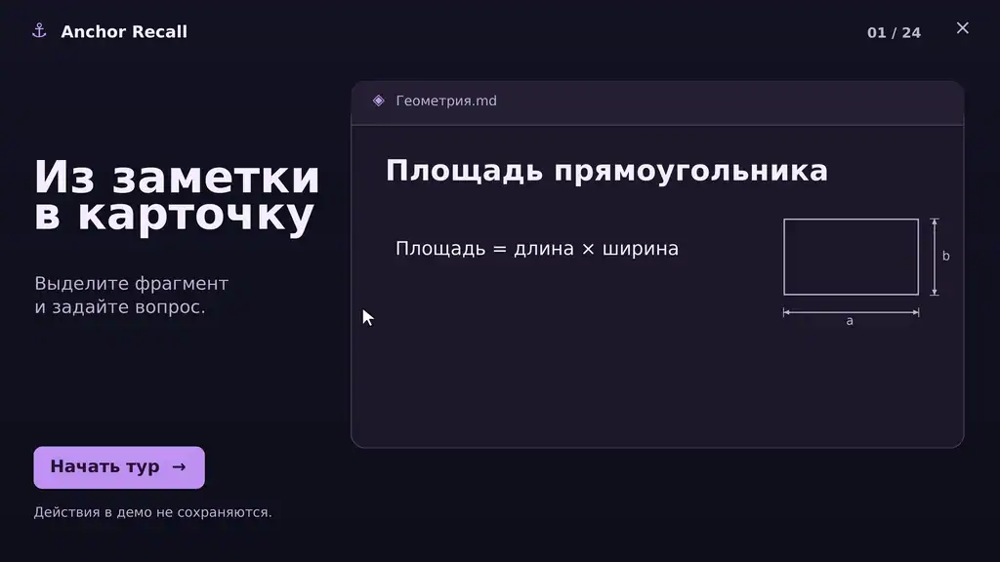](docs/demo/01.webp)

Выделите в заметке то, что хотите запомнить, и превратите это в вопрос. Например, из формулы площади можно сделать карточку «Как найти площадь прямоугольника?»

### Слайд 02

[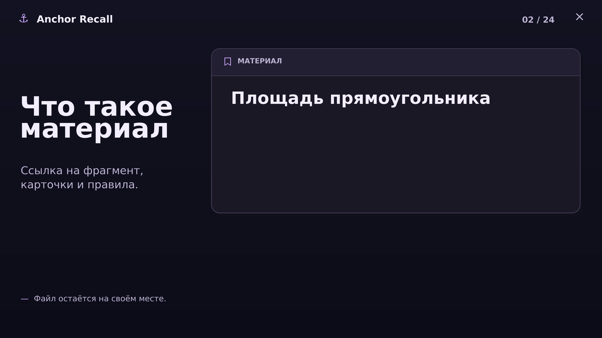](docs/demo/02.webp)

Материал хранит ссылку на нужное место в источнике. К нему можно добавить несколько карточек и объясняющие правила. Исходный файл остаётся на месте.

### Слайд 03

[](docs/demo/03.webp)

Якорь запоминает конкретное место: абзац в заметке, страницу PDF, точку на картинке или отрезок видео. Если источник сильно изменится, точность перехода может снизиться.

### Слайд 04

[](docs/demo/04.webp)

Откройте ссылку из материала, чтобы вернуться к сохранённому месту. Не придётся заново искать нужную формулу по всему файлу.

### Слайд 05

[](docs/demo/05.webp)

Если сейчас некогда составлять вопросы, сохраните материал без карточек. Вопросы и правила можно добавить позже.

### Слайд 06

[](docs/demo/06.webp)

Сначала попробуйте вспомнить ответ без подсказки. Потом раскройте эталон и сравните его со своим ответом. В примере площадь равна 12 квадратным единицам.

### Слайд 07

[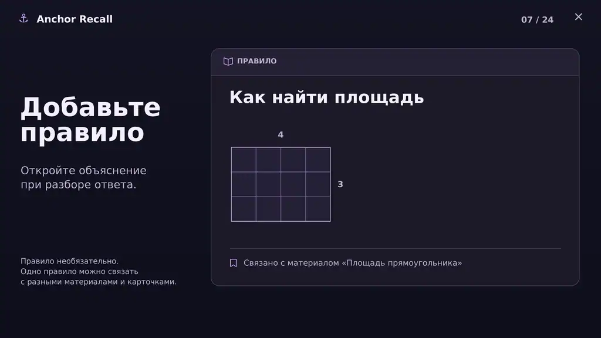](docs/demo/07.webp)

Правило объясняет, как получить ответ. Здесь три ряда по четыре клетки дают 12. Одно правило можно использовать в нескольких карточках.

### Слайд 08

[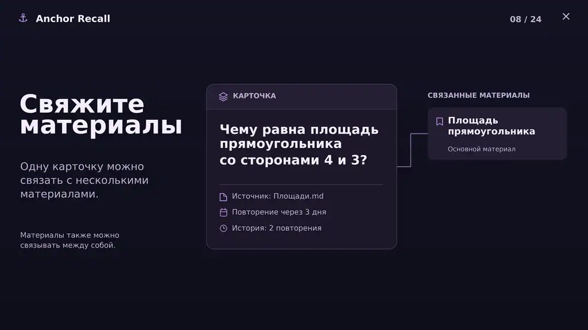](docs/demo/08.webp)

Свяжите карточку с несколькими материалами, если полезно посмотреть разные объяснения. Например, к формуле можно добавить пример на клетчатой бумаге.

### Слайд 09

[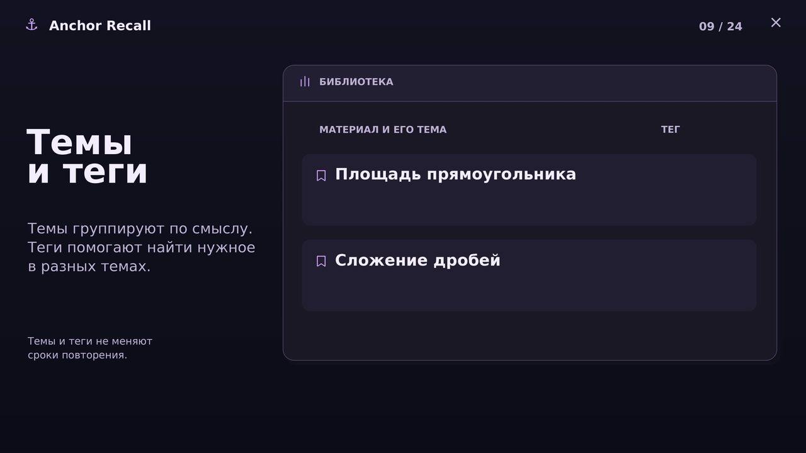](docs/demo/09.webp)

Тема отвечает на вопрос «про что это?», а тег помогает собрать нужное из разных тем. Например, «повторить» можно поставить и на площади, и на дроби.

### Слайд 10

[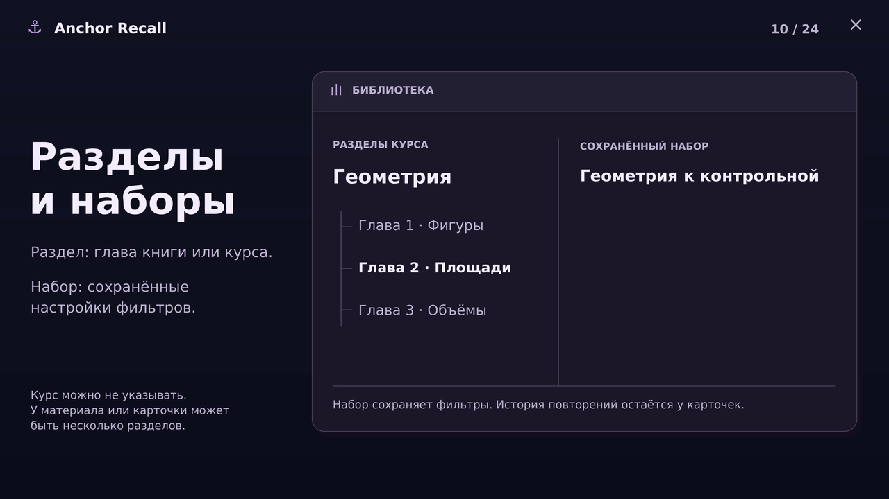](docs/demo/10.webp)

Раздел привязывает материал к главе книги или курса. Набор запоминает выбранные фильтры, чтобы потом открыть ту же подборку одним действием.

### Слайд 11

[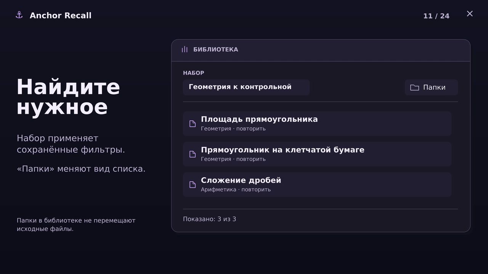](docs/demo/11.webp)

Выберите сохранённый набор, чтобы показать только нужные материалы. Кнопка «Папки» меняет вид списка, но не перемещает файлы в Obsidian.

### Слайд 12

[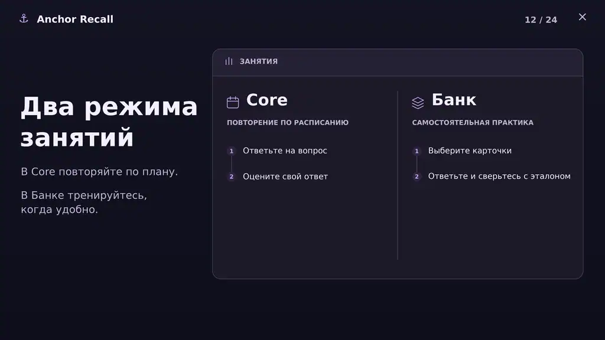](docs/demo/12.webp)

Core подходит для повторений по расписанию: оценка ответа влияет на следующую дату. Банк позволяет потренироваться в любой момент и не сдвигает расписание Core.

### Слайд 13

[](docs/demo/13.webp)

Формат определяет, как вы отвечаете: пишете текст, выбираете варианты, заполняете пропуски, соединяете пары или расставляете шаги. Формат карточки и режим занятия выбираются отдельно.

### Слайд 14

[](docs/demo/14.webp)

Если застряли, откройте подсказку. После ответа можно свериться с эталоном и при необходимости открыть правило или вернуться к источнику.

### Слайд 15

[](docs/demo/15.webp)

В плане на день рядом видны свои задачи, повторения Core и напоминания о материалах. Отметка о выполнении задачи не меняет оценки карточек.

### Слайд 16

[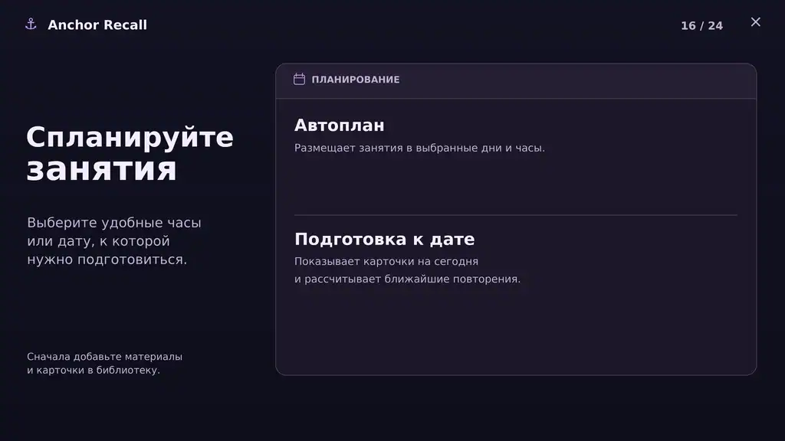](docs/demo/16.webp)

В автоплане задайте дни и часы занятий. Если готовитесь к контрольной или экзамену, укажите дату: плагин покажет, что повторить сегодня и что запланировано дальше.

### Слайд 17

[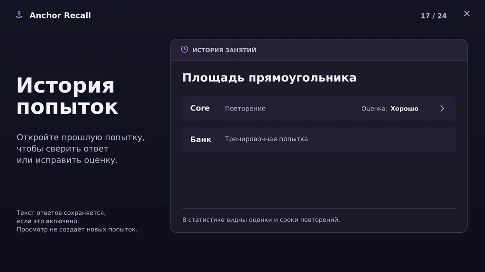](docs/demo/17.webp)

В истории можно открыть прошлую попытку и, если нужно, исправить оценку. Сам просмотр ничего не записывает; текст ответа виден, если его сохранение включено.

### Слайд 18

[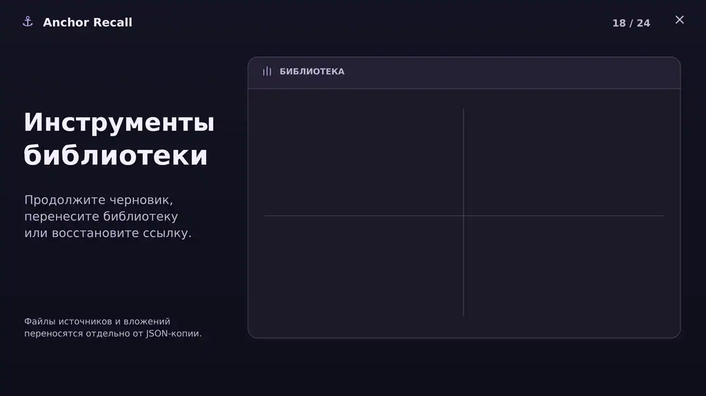](docs/demo/18.webp)

Здесь можно вернуться к черновику, импортировать учебный пакет или восстановить ссылку на перемещённый файл. При переносе в другое хранилище скопируйте источники и вложения отдельно от JSON-копии.

### Слайд 19

[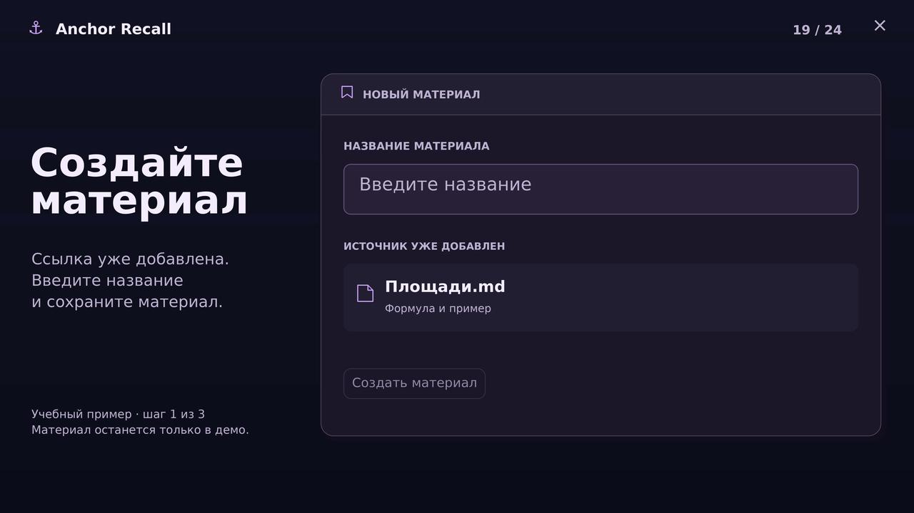](docs/demo/19.webp)

Начните с одной своей заметки: выделите фрагмент, назовите материал и сохраните его. Ссылка на выбранное место уже будет в форме.

### Слайд 20

[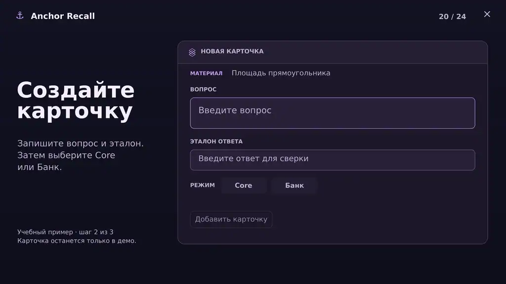](docs/demo/20.webp)

Добавьте к материалу один конкретный вопрос и эталон ответа. Выберите Core для повторений по расписанию или Банк для свободной практики.

### Слайд 21

[](docs/demo/21.webp)

Если одного эталона мало, добавьте правило с объяснением. Этот шаг необязателен: к правилу можно вернуться позже.

### Слайд 22

[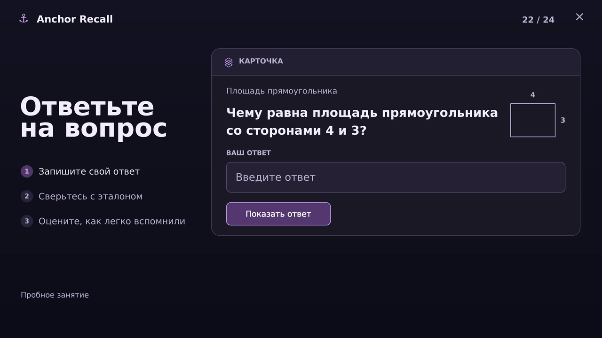](docs/demo/22.webp)

Ответьте, сравните свой ответ с эталоном и оцените, насколько легко вспомнили. В Core эта оценка влияет на срок следующего повторения.

### Слайд 23

[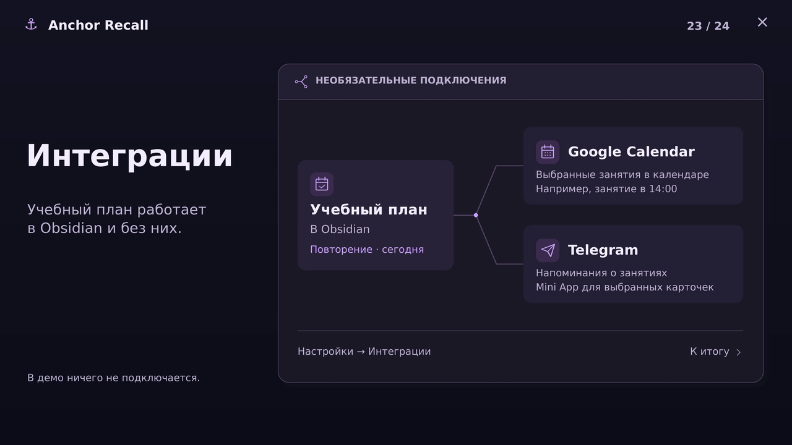](docs/demo/23.webp)

Google Calendar показывает выбранные занятия, а в Telegram можно повторять выбранные карточки. Подключать их необязательно: учебный план работает и без них.

### Слайд 24

[](docs/demo/24.webp)

Для первого занятия хватит одного фрагмента и одной карточки. Возьмите любую свою заметку, создайте материал и попробуйте ответить на вопрос, не подглядывая.

### Telegram

Если хотите повторять выбранные карточки в Telegram, начните с подключения бота. Ролик показывает настройку и первую синхронизацию.

[Пошаговая инструкция](docs/demo/telegram.md)

[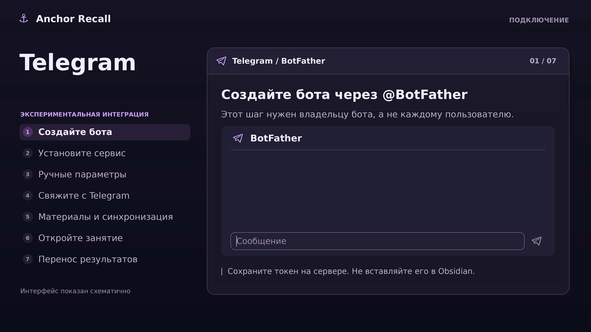](docs/demo/telegram.webp)

### Google Calendar

Подключите Google Календарь, если хотите видеть в нём занятия из плана. В ролике показано подключение через собственный OAuth-клиент.

[Пошаговая инструкция](docs/demo/google-calendar.md)

[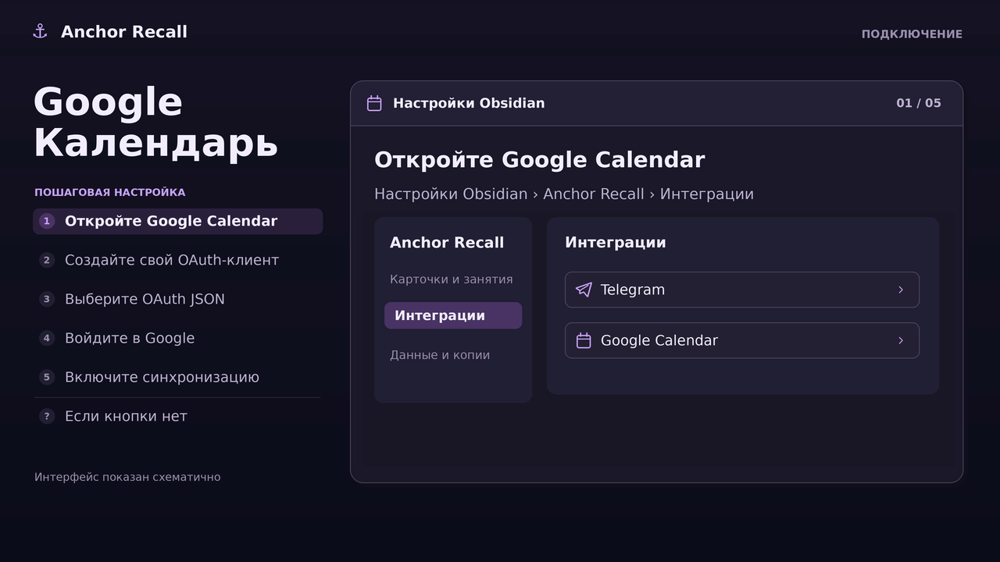](docs/demo/google-calendar.webp)
