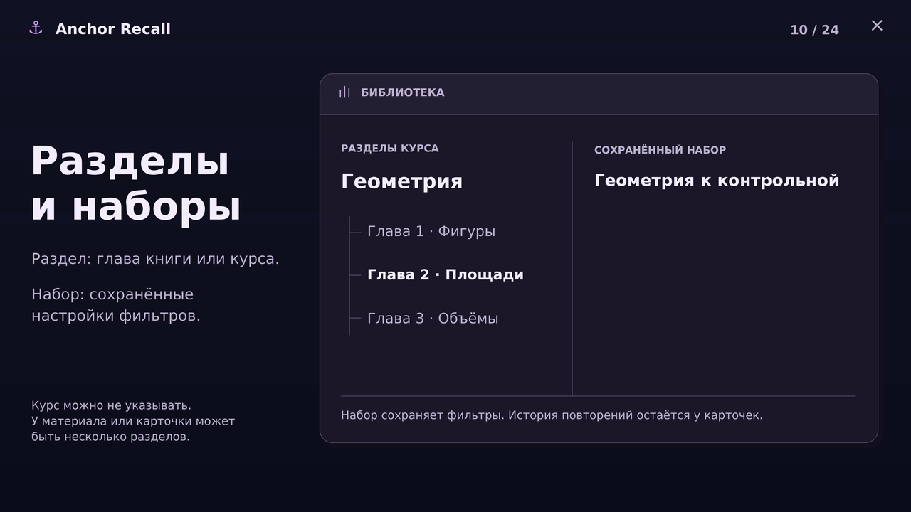
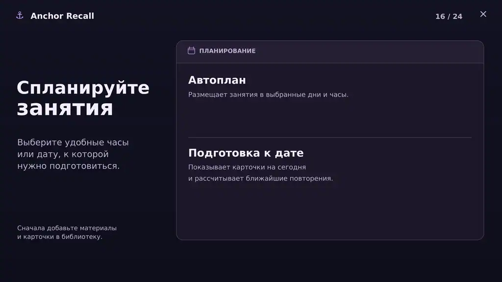
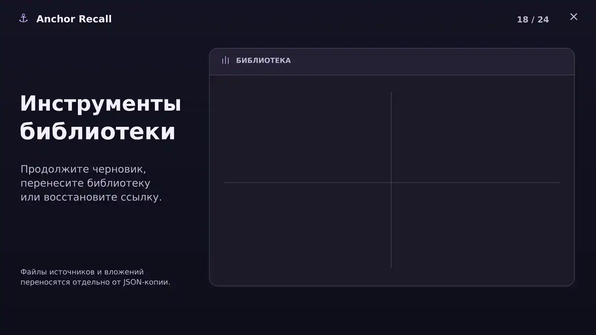
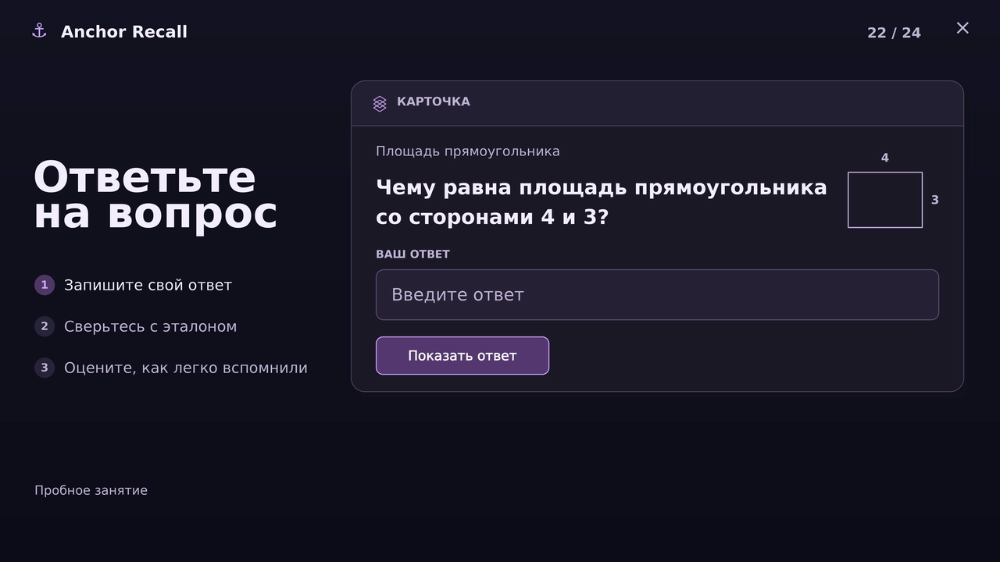

# Демо Anchor Recall

Пройдите слайды по порядку. Раскройте нужный пункт. Если анимация закончилась, откройте её отдельно, чтобы посмотреть сначала. Для настройки интеграций рядом с видео есть текстовые инструкции.

## Основная презентация

Слайд 01

[Открыть анимацию отдельно](01.webp)

Слайд 02

[Открыть анимацию отдельно](02.webp)

Слайд 03

[Открыть анимацию отдельно](03.webp)

Слайд 04

[Открыть анимацию отдельно](04.webp)

Слайд 05

[Открыть анимацию отдельно](05.webp)

Слайд 06

[Открыть анимацию отдельно](06.webp)

Слайд 07

[Открыть анимацию отдельно](07.webp)

Слайд 08

[Открыть анимацию отдельно](08.webp)

Слайд 09

[Открыть анимацию отдельно](09.webp)

Слайд 10

[Открыть анимацию отдельно](10.webp)

Слайд 11

[Открыть анимацию отдельно](11.webp)

Слайд 12

[Открыть анимацию отдельно](12.webp)

Слайд 13

[Открыть анимацию отдельно](13.webp)

Слайд 14

[Открыть анимацию отдельно](14.webp)

Слайд 15

[Открыть анимацию отдельно](15.webp)

Слайд 16

[Открыть анимацию отдельно](16.webp)

Слайд 17

[Открыть анимацию отдельно](17.webp)

Слайд 18

[Открыть анимацию отдельно](18.webp)

Слайд 19

[Открыть анимацию отдельно](19.webp)

Слайд 20

[Открыть анимацию отдельно](20.webp)

Слайд 21

[Открыть анимацию отдельно](21.webp)

Слайд 22

[Открыть анимацию отдельно](22.webp)

Слайд 23

[Открыть анимацию отдельно](23.webp)

Слайд 24

[Открыть анимацию отдельно](24.webp)

## Telegram

[Пошаговая инструкция](telegram.md)

Показать подключение

[Открыть анимацию отдельно](telegram.webp)

## Google Calendar

[Пошаговая инструкция](google-calendar.md)

Показать подключение

[Открыть анимацию отдельно](google-calendar.webp)

