# Демо Anchor Recall

Листайте слайды по порядку или выберите номер. Под каждым слайдом есть короткое пояснение. Нажмите на анимацию, чтобы открыть её отдельно. Кнопки, нарисованные внутри неё, не работают.

[01](#слайд-01) · [02](#слайд-02) · [03](#слайд-03) · [04](#слайд-04) · [05](#слайд-05) · [06](#слайд-06) · [07](#слайд-07) · [08](#слайд-08) · [09](#слайд-09) · [10](#слайд-10) · [11](#слайд-11) · [12](#слайд-12) · [13](#слайд-13) · [14](#слайд-14) · [15](#слайд-15) · [16](#слайд-16) · [17](#слайд-17) · [18](#слайд-18) · [19](#слайд-19) · [20](#слайд-20) · [21](#слайд-21) · [22](#слайд-22) · [23](#слайд-23) · [24](#слайд-24)

[Telegram](#telegram) · [Google Calendar](#google-calendar)

[Сразу к первому занятию (слайды 19–22)](#слайд-19)

## Основная презентация

### Слайд 01

Выделите в заметке то, что хотите запомнить, и превратите это в вопрос. Например, из формулы площади можно сделать карточку «Как найти площадь прямоугольника?»

### Слайд 02

[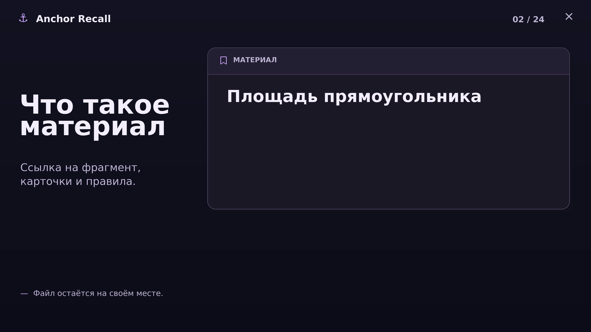](02.webp)

Материал хранит ссылку на нужное место в источнике. К нему можно добавить несколько карточек и объясняющие правила. Исходный файл остаётся на месте.

### Слайд 03

[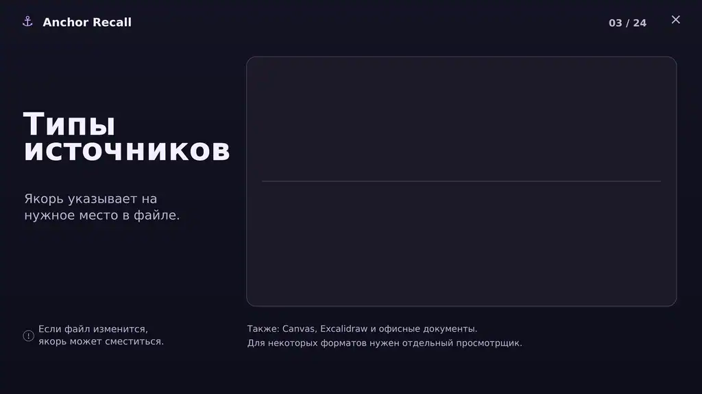](03.webp)

Якорь запоминает конкретное место: абзац в заметке, страницу PDF, точку на картинке или отрезок видео. Если источник сильно изменится, точность перехода может снизиться.

### Слайд 04

[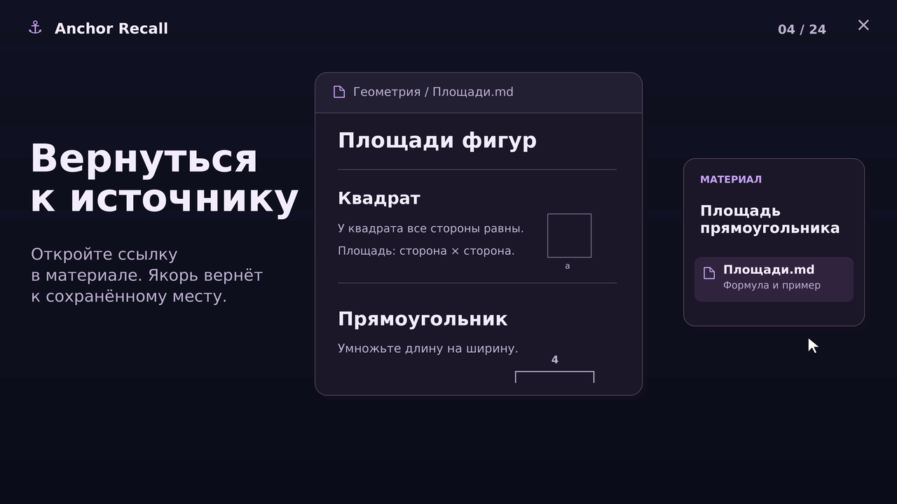](04.webp)

Откройте ссылку из материала, чтобы вернуться к сохранённому месту. Не придётся заново искать нужную формулу по всему файлу.

### Слайд 05

[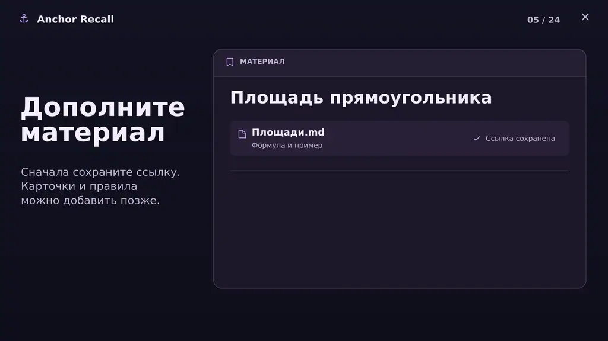](05.webp)

Если сейчас некогда составлять вопросы, сохраните материал без карточек. Вопросы и правила можно добавить позже.

### Слайд 06

Сначала попробуйте вспомнить ответ без подсказки. Потом раскройте эталон и сравните его со своим ответом. В примере площадь равна 12 квадратным единицам.

### Слайд 07

[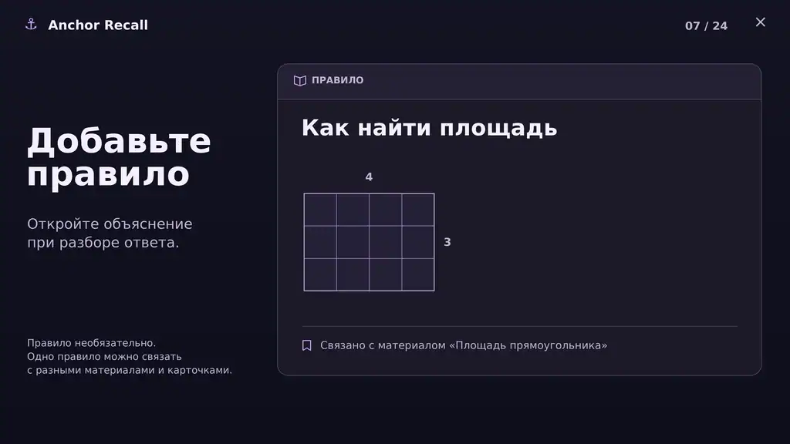](07.webp)

Правило объясняет, как получить ответ. Здесь три ряда по четыре клетки дают 12. Одно правило можно использовать в нескольких карточках.

### Слайд 08

Свяжите карточку с несколькими материалами, если полезно посмотреть разные объяснения. Например, к формуле можно добавить пример на клетчатой бумаге.

### Слайд 09

Тема отвечает на вопрос «про что это?», а тег помогает собрать нужное из разных тем. Например, «повторить» можно поставить и на площади, и на дроби.

### Слайд 10

Раздел привязывает материал к главе книги или курса. Набор запоминает выбранные фильтры, чтобы потом открыть ту же подборку одним действием.

### Слайд 11

[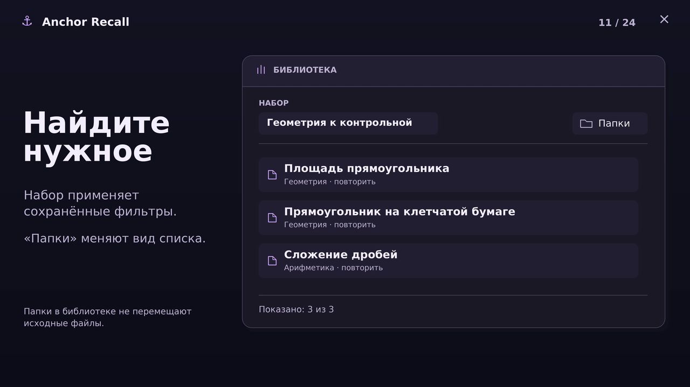](11.webp)

Выберите сохранённый набор, чтобы показать только нужные материалы. Кнопка «Папки» меняет вид списка, но не перемещает файлы в Obsidian.

### Слайд 12

[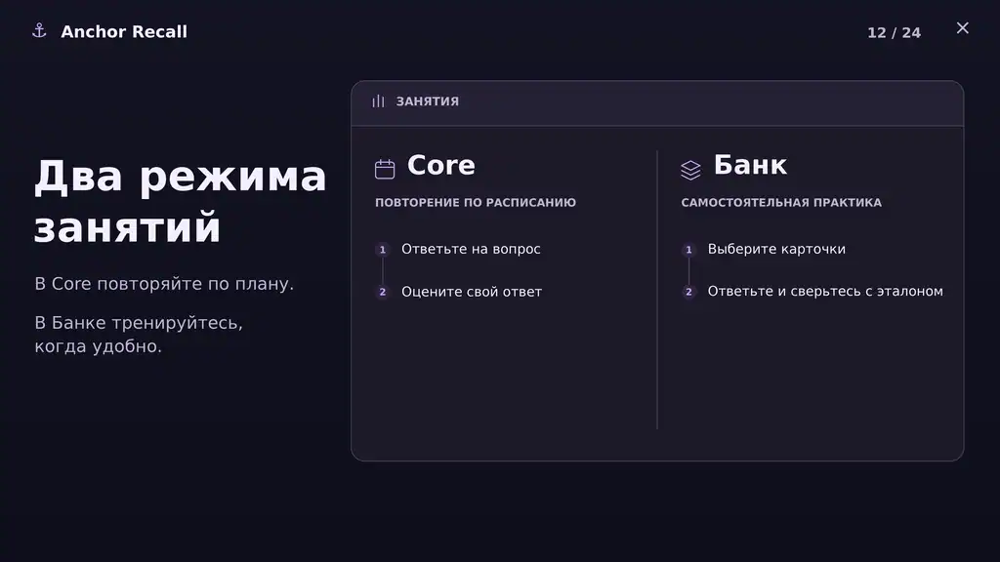](12.webp)

Core подходит для повторений по расписанию: оценка ответа влияет на следующую дату. Банк позволяет потренироваться в любой момент и не сдвигает расписание Core.

### Слайд 13

[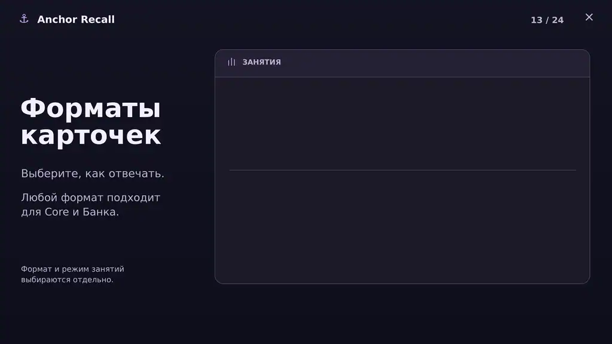](13.webp)

Формат определяет, как вы отвечаете: пишете текст, выбираете варианты, заполняете пропуски, соединяете пары или расставляете шаги. Формат карточки и режим занятия выбираются отдельно.

### Слайд 14

[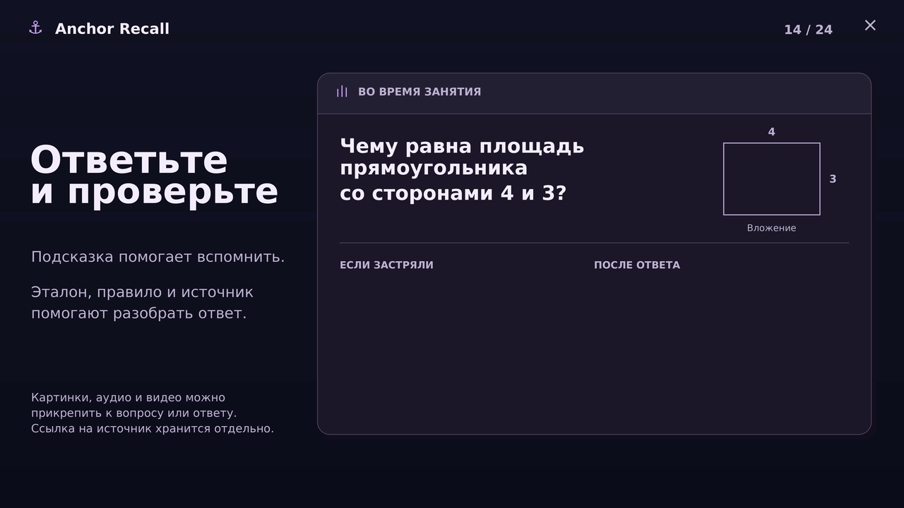](14.webp)

Если застряли, откройте подсказку. После ответа можно свериться с эталоном и при необходимости открыть правило или вернуться к источнику.

### Слайд 15

[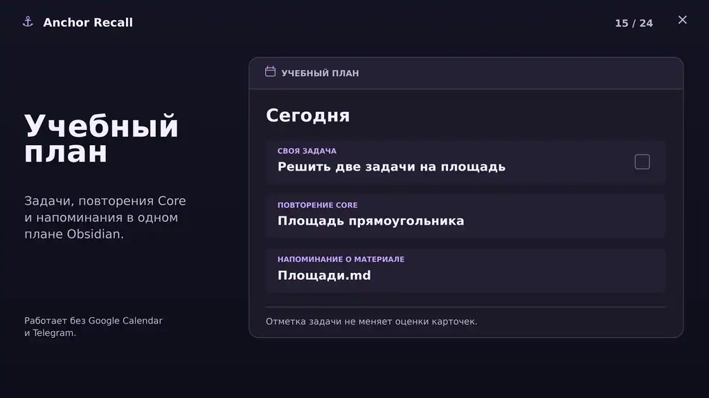](15.webp)

В плане на день рядом видны свои задачи, повторения Core и напоминания о материалах. Отметка о выполнении задачи не меняет оценки карточек.

### Слайд 16

В автоплане задайте дни и часы занятий. Если готовитесь к контрольной или экзамену, укажите дату: плагин покажет, что повторить сегодня и что запланировано дальше.

### Слайд 17

[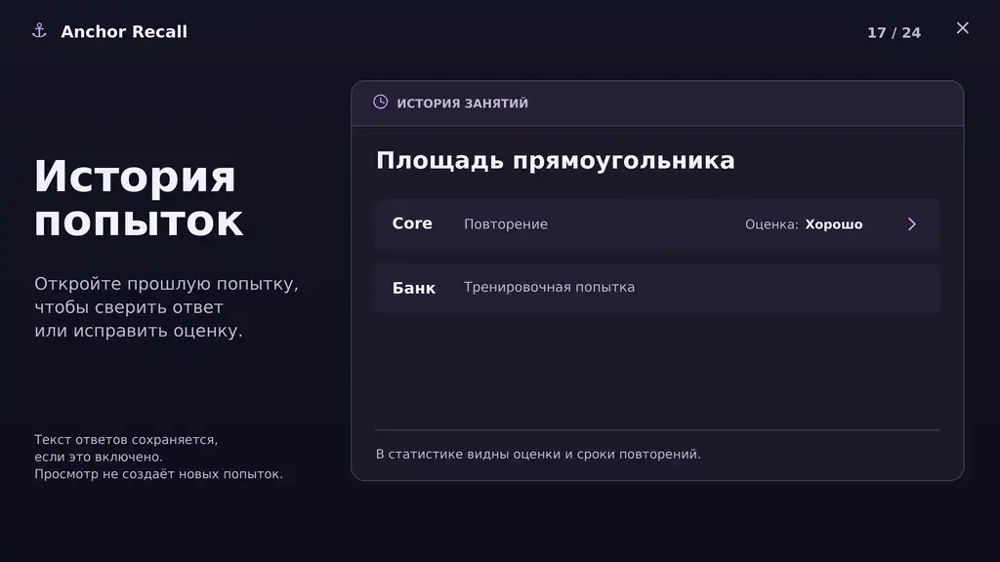](17.webp)

В истории можно открыть прошлую попытку и, если нужно, исправить оценку. Сам просмотр ничего не записывает; текст ответа виден, если его сохранение включено.

### Слайд 18

Здесь можно вернуться к черновику, импортировать учебный пакет или восстановить ссылку на перемещённый файл. При переносе в другое хранилище скопируйте источники и вложения отдельно от JSON-копии.

### Слайд 19

[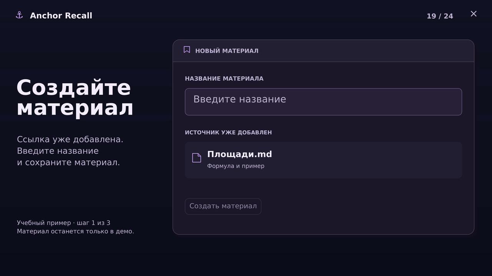](19.webp)

Начните с одной своей заметки: выделите фрагмент, назовите материал и сохраните его. Ссылка на выбранное место уже будет в форме.

### Слайд 20

[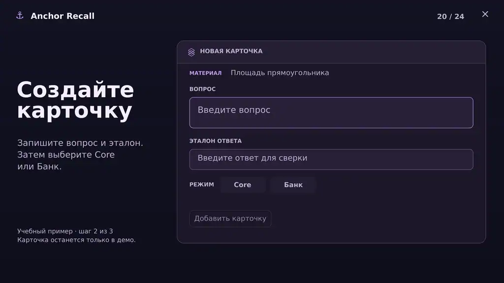](20.webp)

Добавьте к материалу один конкретный вопрос и эталон ответа. Выберите Core для повторений по расписанию или Банк для свободной практики.

### Слайд 21

[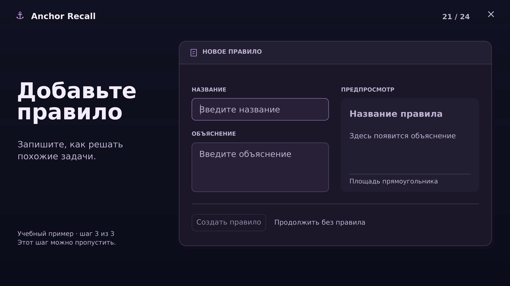](21.webp)

Если одного эталона мало, добавьте правило с объяснением. Этот шаг необязателен: к правилу можно вернуться позже.

### Слайд 22

Ответьте, сравните свой ответ с эталоном и оцените, насколько легко вспомнили. В Core эта оценка влияет на срок следующего повторения.

### Слайд 23

[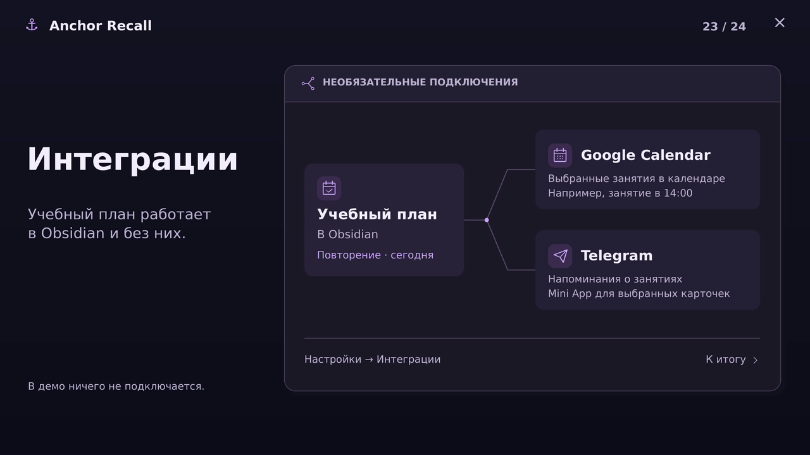](23.webp)

Google Calendar показывает выбранные занятия, а в Telegram можно повторять выбранные карточки. Подключать их необязательно: учебный план работает и без них.

### Слайд 24

[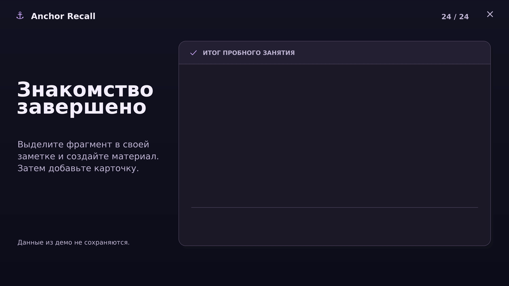](24.webp)

Для первого занятия хватит одного фрагмента и одной карточки. Возьмите любую свою заметку, создайте материал и попробуйте ответить на вопрос, не подглядывая.

## Telegram

Если хотите повторять выбранные карточки в Telegram, начните с подключения бота. Ролик показывает настройку и первую синхронизацию.

[Пошаговая инструкция](telegram.md)

## Google Calendar

Подключите Google Календарь, если хотите видеть в нём занятия из плана. В ролике показано подключение через собственный OAuth-клиент.

[Пошаговая инструкция](google-calendar.md)

[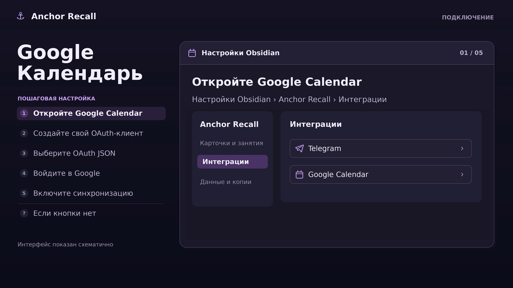](google-calendar.webp)
